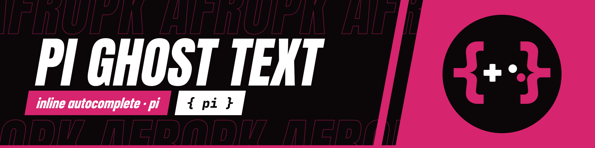
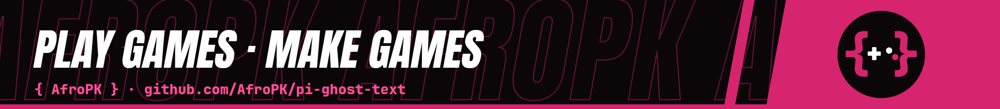

<p align="center">
  
</p>

<p align="center">
  
  
  
  
</p>

<p></p>

**`{ pi-ghost-text }`**: ghost-text prompt suggestions for the pi coding agent, like Claude Code's inline autocomplete.

As you type, or after the agent finishes and the box is empty, a dimmed prediction of your likely next prompt appears after the cursor. Accept it, cycle alternatives, or keep typing.

> [!NOTE]
> Interactive TUI only. Suggestions are an editor feature, so they don't run in `-p`/`--print`, `--mode json` or `--mode rpc`. The suggestion model needs a configured API key.

<p></p>

| | Feature | What it does |
|---|---|---|
| ⌨️ | **While typing** | After ~700 ms of plain text (4+ chars), a prefix-anchored ghost appears and shrinks as you type. |
| 🌙 | **After a turn** | When the agent settles and the box is empty, you get a next-prompt suggestion. |
| 🔁 | **Candidates** | Set 2-3 and `Tab` cycles them instead of accepting the first. |
| 🔒 | **Privacy first** | Sends only your typed text and the last few messages, trimmed. No transcript, tool output or file contents. |

<p></p>

**Needs:** pi in interactive TUI mode · an API key for a fast model

```bash
pi install npm:pi-ghost-text
# remove it
pi remove npm:pi-ghost-text
```

<p></p>

| Key | Action |
|---|---|
| `Tab` | Cycle to the next candidate; accept when it's the last or only one |
| `→` (cursor at end) | Accept the suggestion |
| `Esc` | Dismiss the ghost, keep what you typed |
| Move the cursor away | Dismiss |
| Keep typing | Shrink while it still matches, otherwise regenerate |

`Tab` only applies when the file/command autocomplete dropdown is closed. Accepting puts the text in the editor so you can edit it before pressing `Enter`.

Commands: `/suggest` (mode: `both`, `while-typing`, `after-turn`, `off`), `/suggest-model`, `/suggest-context`.

<p></p>

Global `~/.pi/agent/prompt-suggestions.json`, project `.pi/prompt-suggestions.json`, resolved defaults ← global ← project.

```json
{
  "model": "auto",
  "mode": "both",
  "candidates": 1,
  "streaming": true,
  "contextMessages": 8,
  "contextChars": 600,
  "maxPerTurn": 0,
  "debug": false
}
```

`model: "auto"` scans for a fast, cheap model (`haiku`, then `gpt-*mini`, then `flash`, then `nano`) and falls back to the session model. `candidates`, `streaming`, `maxPerTurn` and `debug` are JSON-only; commands always write the global scope.

<p></p>

- No suggestion? Check `/suggest` isn't `off`, then `/suggest-model` — an explicit model that isn't found silently falls back to the session model.
- Set `"debug": true` to log reasons (`timeout`, `error`, `no-suggestion`) to `~/.pi/agent/prompt-suggestions.log`.
- If streaming ghosts flake, set `"streaming": false`.
- Tests: `npm ci --ignore-scripts && npm test` (Node 23.6+). The rendering tests use the real `Editor` from `@earendil-works/pi-tui`.
- Inspired by [supi-prompt-suggestions](https://pi.dev/packages/@mrclrchtr/supi-prompt-suggestions?name=supi).

<p align="center">
  
</p>
